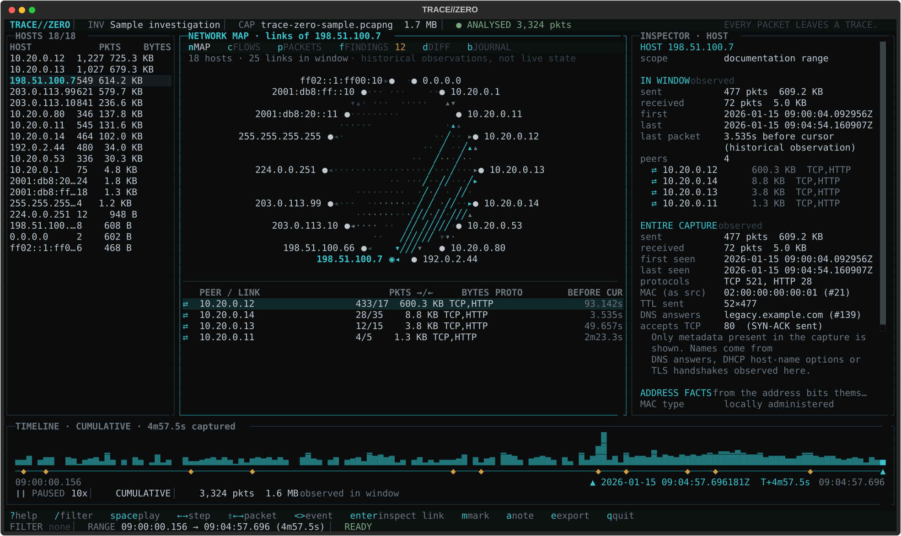
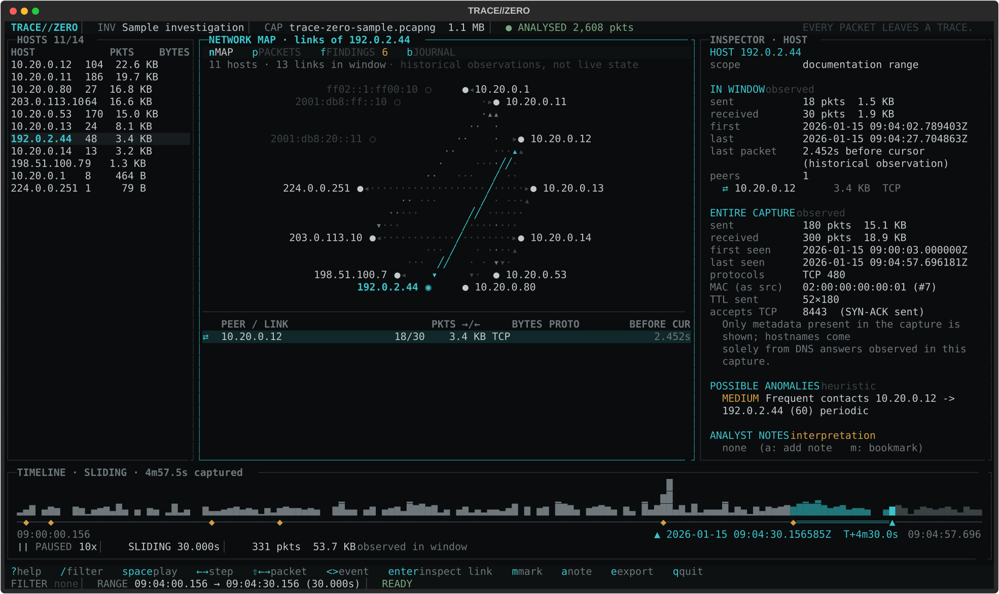
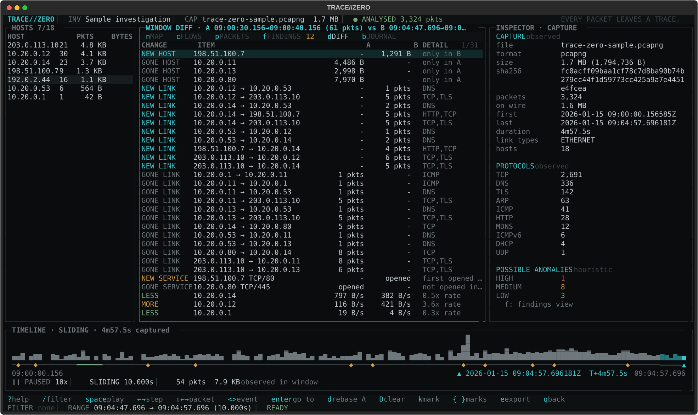
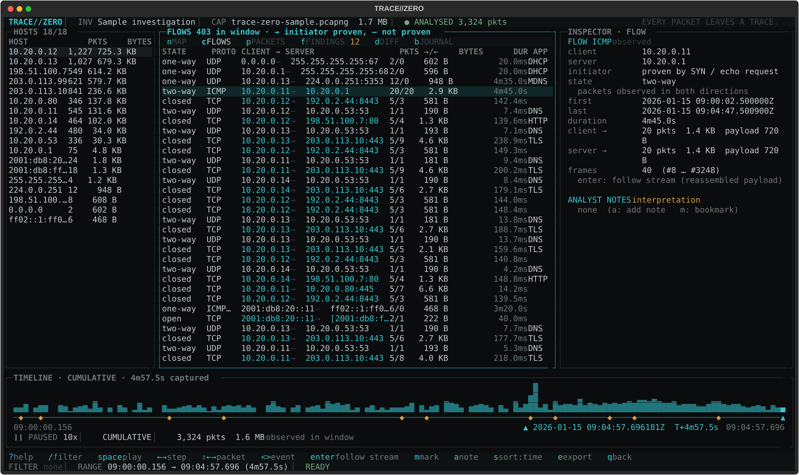
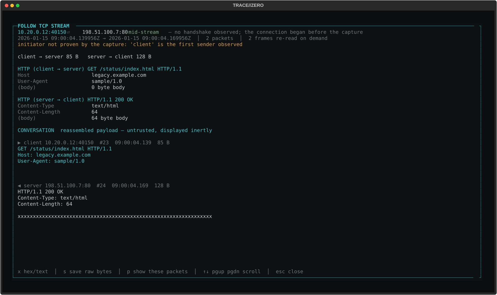
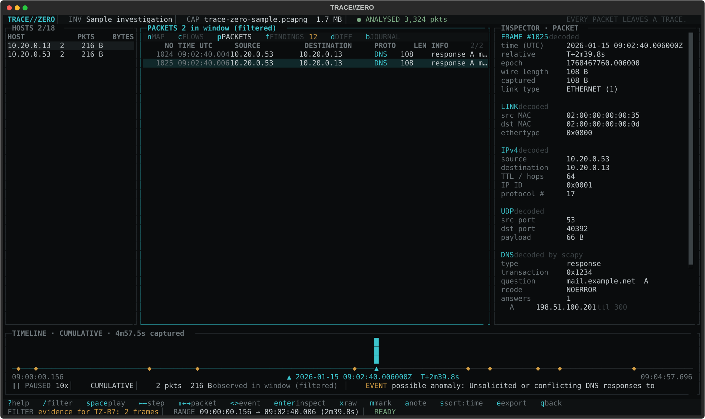
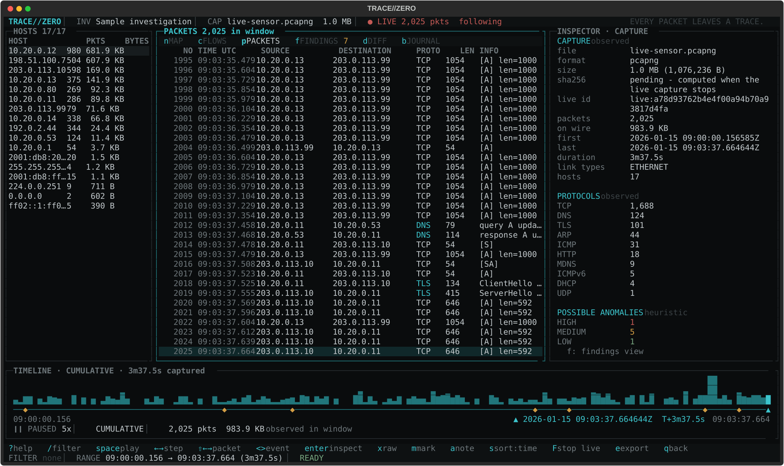

# TRACE//ZERO

**EVERY PACKET LEAVES A TRACE.**

TRACE//ZERO is a keyboard-driven terminal instrument for network forensics.
Open a PCAP or PCAPNG capture - or follow one while it is being recorded - scrub through it with a deterministic time machine,
watch hosts and links appear on a network map as the cursor moves, follow reassembled
streams, compare two moments of the capture, review transparent anomaly heuristics, and
keep triage, notes, bookmarks and hashed exports in a persistent investigation.



<sub>Every screenshot in this repository is rendered from the running application by
`scripts/capture_screenshots.py` (Textual's own SVG export, real keystrokes, synthetic sample capture).</sub>

---

## What it is - and is not

* **It reads files.** It analyses capture files you explicitly choose, including files that are
  still growing (live mode). It never captures packets itself, never asks for administrator
  privileges, and makes no network connections. For live capture it can start Wireshark's
  `dumpcap` or `tcpdump`; only that tool needs capture permission, and the capture is passive,
  receive-only and never promiscuous.
* **Evidence stays read-only.** Captures are opened read-only and hashed (SHA-256) at import.
  Re-verify them at any time (`V`, or `trace-zero --verify`); every export gets a `.sha256` sidecar.
* **Nothing leaves the machine.** No telemetry, no uploads, no online lookups. MAC vendor and
  GeoIP/ASN data come only from local files you provide. Exported HTML reports carry a
  Content-Security-Policy that blocks scripts and remote fetches.
* **No offensive features.** No scanning, exploitation, credential harvesting or interception.
* **Explainable, not oracular.** Heuristics flag *possible anomalies* with the rule, numbers,
  supporting frames and a confidence statement. They never claim malicious intent.

## Features (implemented and covered by tests)

| Area | What you get |
| --- | --- |
| Import | PCAP (µs and ns) and PCAPNG; Ethernet, 802.1Q/QinQ, Linux SLL/SLL2, BSD loopback, raw IPv4/IPv6. Background import with progress, `esc` to cancel. Malformed, truncated and empty files are reported, not fatal. Several captures (for example two sensors) can be merged onto one timeline. |
| Live mode | Follow a PCAP/PCAPNG file while another program writes it, or start `dumpcap`/`tcpdump` on an interface (`F`). Every view, filter, finding, flow and export works on the data received so far; the timeline keeps following the newest packets. Stopping hashes the finished file and analyses it exactly as an offline import. |
| Instant reopen | Parsed captures, indexes, findings and flows are cached on disk keyed by the file's SHA-256. Reopening a 263k-packet capture takes ~1.5 s instead of ~16 s. |
| Decoding | Timestamps, MACs, VLAN, IPv4/IPv6 (incl. extension headers, fragments), TCP, UDP, ICMP/ICMPv6 (including the quoted packet inside errors), ARP, DHCP (hostname, requested/assigned address, lease), DNS/mDNS/LLMNR, HTTP request/status lines, TLS ClientHello (SNI, ALPN, versions, **JA3**, **JA4**), ServerHello (**JA3S**) and certificates (subject/issuer CN, SANs; TLS 1.2 and below). Absent fields stay empty - never guessed. |
| Hosts | Per-window and whole-capture traffic, peers, MACs, TTLs, ports accepting TCP, names **only** when DNS, DHCP or TLS in the capture shows them, TLS fingerprints, and optional offline MAC vendor / country / ASN. |
| Network map | Deterministic layout; hosts appear when first observed; arrowheads show observed packet direction; selected host's links highlighted; dormant hosts dimmed in sliding windows. |
| Flows | Connection table (`c`) with state, initiator (proven by a SYN or echo request, or marked unproven), bytes per direction and application. `enter` follows the **reassembled stream**: TCP reassembly with retransmission, overlap-conflict and gap reporting; HTTP messages, TLS handshakes and DNS over TCP decoded; hex or text view; save raw bytes. |
| Packets | Virtualised list (a million rows cost the same as ten), sortable, filterable, chronological stepping, full decode, optional raw hex + full scapy dissection. |
| Packet export | `X` writes the packets shown (filter + time window, or a finding's evidence) to a new PCAPNG, copied byte-for-byte with nanosecond timestamps, and copies an equivalent **Wireshark display filter** to the clipboard (31 translations verified against `tshark`). |
| Time machine | Cursor, cumulative or sliding window, play/pause, 15 replay speeds, step by window, packet, significant event or **named mark** (`k`, `{` `}`). **Window diff** (`d`): pin window A, move to B, and see new/gone hosts, links and services and rate changes. |
| Heuristics | Ten rules: failed connections, port fan-out, traffic spikes, DNS spikes, frequent/periodic host pairs, ARP address conflicts, unsolicited or conflicting DNS answers, heavy outbound transfer, late new external destinations, TLS SNI vs DNS mismatch. Each with severity, hosts, timestamps, frames, rule, explanation and confidence. |
| Triage | Mark findings open / benign / escalated with a reason (`T`); suppress noisy patterns per rule and host with a required reason (`z`), reversible and exported. |
| Investigations | Create, rename, switch; bookmarks; analyst notes; timeline marks; activity journal; JSON and HTML export with chain-of-custody records. Stored in SQLite. |
| Interface | Full-screen Textual TUI, keyboard only, contextual shortcut bar, help overlay, command palette (`ctrl+p`), filter history and saved filters, compact single-panel mode below 130 columns, guard screen below 60x16. |

## Install

Requires Python 3.11+ (tested on 3.11, 3.12 and 3.13) or one of the standalone executables.

### Standalone executable

Tagged releases attach single-file executables for Linux x86-64, Windows x86-64 and macOS
arm64 (built by [.github/workflows/release.yml](.github/workflows/release.yml), each one
smoke-tested offline before publishing) together with `SHA256SUMS`. Check the hash, then run it:

```bash
sha256sum -c SHA256SUMS --ignore-missing
chmod +x trace-zero-*-linux-x86_64 && ./trace-zero-*-linux-x86_64 --version
```

On Windows you can simply double-click the `.exe`: the start screen has buttons (and keys) for
opening a capture (`o`) and for live mode (`Shift+F` - a capital F; lowercase `f` is findings), and the file browser starts in your Downloads folder (then in the folder you
used last), with quick jumps to Desktop, Documents, home, the exports folder and every drive.
The executables are not code-signed: Windows SmartScreen asks you to confirm (*More info*,
*Run anyway*), and on macOS run `xattr -d com.apple.quarantine` on the file first.

### From a release wheel

Each GitHub release also carries the Python package (`trace_zero-X.Y.Z-py3-none-any.whl`):

```bash
pipx install ./trace_zero-0.1.3-py3-none-any.whl    # or: python -m pip install ./trace_zero-...whl
```

It is not on PyPI yet; the release workflow publishes there once PyPI publishing is enabled
(see *Releasing* below).

### From source - Linux

```bash
git clone https://github.com/Ethan21Dev/trace-zero.git
cd trace-zero
python3 -m venv .venv
. .venv/bin/activate
pip install -e ".[dev]"

trace-zero --generate-sample sample.pcapng --format pcapng   # synthetic, safe sample
trace-zero sample.pcapng
```

### From source - Debian / Ubuntu on WSL

```bash
sudo apt update && sudo apt install -y python3 python3-venv python3-pip git
git clone https://github.com/Ethan21Dev/trace-zero.git && cd trace-zero
python3 -m venv .venv && . .venv/bin/activate
pip install -e ".[dev]"
trace-zero --generate-sample sample.pcapng --format pcapng
trace-zero sample.pcapng
# Windows files are reachable under /mnt/c, e.g.:
trace-zero /mnt/c/Users/<you>/Downloads/capture.pcapng
```

Run it inside **Windows Terminal** (the WSL profile) for full colour and Unicode support.

### From source - Windows (Windows Terminal + PowerShell)

```powershell
git clone https://github.com/Ethan21Dev/trace-zero.git
cd trace-zero
py -3.12 -m venv .venv
.\.venv\Scripts\Activate.ps1
pip install -e ".[dev]"
trace-zero --generate-sample sample.pcapng --format pcapng
trace-zero sample.pcapng
```

No Npcap/WinPcap is needed to analyse files (live capture on an interface uses Wireshark's
dumpcap, which brings Npcap). Use Windows Terminal rather than
the legacy console host. See [docs/SETUP.md](docs/SETUP.md) for fonts, sizes and details.

### Other ways to run

```bash
python -m trace_zero capture.pcap                  # without the console script
trace-zero capture.pcap -i "Case 2026-114"         # open or create a named investigation
trace-zero sensor-a.pcapng sensor-b.pcapng         # merge captures onto one timeline
trace-zero                                         # start empty, press o to open a file
```

## Using it

```
 HEADER    TRACE//ZERO | investigation | capture | import status
 HOSTS     |  CENTER: map / flows / packets / findings / diff / journal  |  INSPECTOR
 TIMELINE  activity histogram, cursor, window, finding and mark markers, replay state
 STATUS    contextual keys | filter | selected range | app status
```

| Key | Action | Key | Action |
| --- | --- | --- | --- |
| `o` `O` | open capture, add capture | `space` | play / pause replay |
| `/` | search / filter | `←` `→` | step cursor |
| `h` `n` `c` `p` | hosts, map, flows, packets | `⇧←` `⇧→` | previous / next packet |
| `f` `d` `b` | findings, window diff, journal | `<` `>` | previous / next significant event |
| `t` `i` | timeline, inspector | `home` `end` | start / end |
| `enter` | open selected / follow stream | `+` `-` | replay speed |
| `esc` | close / cancel / clear | `w` `[` `]` | window mode and width |
| `m` `a` | bookmark, note | `k` `{` `}` | add mark, previous / next mark |
| `T` `z` `Z` | triage, suppress, show suppressed | `s` `S` | sort / reverse |
| `x` | raw bytes + scapy dissection | `X` | export packets to PCAPNG |
| `e` | export JSON + HTML | `V` | verify evidence hashes |
| `F` | live: follow / capture, stop | | |
| `ctrl+p` | command palette | `r` `ctrl+n` `l` | rename, new, list investigations |
| `?` | help | `q` | back, then quit |

Full reference: [docs/KEYBINDINGS.md](docs/KEYBINDINGS.md) (generated from the in-app keymap).

### Filter language

```
host:10.20.0.12 proto:tcp !port:445        # TCP to/from a host, excluding SMB
proto:dns|mdns dns:telemetry               # DNS questions containing "telemetry"
flags:S !flags:A dport:1-1024              # bare SYNs to low ports
t>200 t<205 len>1000                       # large frames in a 5-second slice
host:10.20.0.0/24 error                    # frames with decode issues from a subnet
```

The filter drives everything: packet list, flows, hosts, map, histogram and replay. In the
filter dialog, `up`/`down` walk the history, `ctrl+s` saves the expression under a name, and
`tab` reaches the saved filters. Saved and recent filters are also in the command palette.

### The network time machine

The cursor defines what has been **observed**: in `CUMULATIVE` mode everything from the
first packet up to the cursor, in `SLIDING` mode only the last *width* seconds. Hosts appear
on the map when first observed; links show how long before the cursor they were last seen.
These are historical observations from the capture - TRACE//ZERO never presents them as live
connection state.

Replay is deterministic: the displayed state is a pure function of capture, filter, cursor,
window mode and width. Playback merely moves the cursor.



`k` drops a named mark at the cursor (shown on the timeline, stepped with `{` `}`, exported).
`d` pins the current window as baseline A and opens the diff; window B follows the cursor:



### Flows and streams



`enter` on a flow reassembles it from the original file. Gaps, retransmissions and
retransmissions that *changed* bytes are reported instead of being silently smoothed over;
the initiator is only stated when the capture proves it.



### Possible anomalies

| Rule | Looks for |
| --- | --- |
| `TZ-R1` | Repeated **failed** TCP connection attempts (refused or unanswered SYNs) to one destination port |
| `TZ-R2` | One source initiating connections to many distinct destination ports in a short window |
| `TZ-R3` | Bytes per time bin far above the capture's own median (robust z-score) |
| `TZ-R4` | DNS query bursts relative to the source's own baseline (with NXDOMAIN and uniqueness context) |
| `TZ-R5` | Host pairs with far more separate contacts than others, or contacts at a very regular interval |
| `TZ-R6` | One IPv4 address announced by several MAC addresses in ARP |
| `TZ-R7` | DNS responses that match no query from that client, or conflicting duplicate answers |
| `TZ-R8` | An internal host sending far more to an external host than it receives |
| `TZ-R9` | External destinations that first appear late in the capture |
| `TZ-R10` | A TLS server name sent to an address that the capture's DNS answers for that name never contained |

`enter` on a finding turns its supporting frames into the packet list and the timeline,
so the evidence can be replayed packet by packet - and exported with `X`. `T` records a
triage decision; `z` suppresses findings like the selected one (reason required, reversible,
exported). Details and thresholds: [docs/HEURISTICS.md](docs/HEURISTICS.md).



### Live mode



`F` offers two ways in:

* **Follow a file** that another program is writing - `dumpcap -w`, `tcpdump -U -w`, a sensor,
  a mirror-port recorder you already run. TRACE//ZERO needs only read access to the file.
* **Capture on an interface**: TRACE//ZERO starts `dumpcap` (preferred) or `tcpdump` as a separate
  process, lets you pick an interface from the tool's own list and an optional BPF capture filter,
  and follows the file it writes to the export folder.

```bash
trace-zero --follow /captures/sensor.pcapng            # follow a growing file
trace-zero --list-interfaces                            # what the capture tool can see
trace-zero --capture eth0 --capture-filter "not port 22"
```

How it behaves:

* The header shows `LIVE n pkts`. While the timeline cursor is at the end it follows new packets;
  move it back to examine the past without being dragged forward.
* Everything works while capture runs: filters, flows and follow stream, findings, triage, marks,
  bookmarks, raw bytes and exports (marked as taken during a live capture).
* Each refresh re-analyses everything received so far, so live results equal an offline analysis
  of the same bytes. Refreshes adapt to the cost: about every second for small captures,
  every ~10 s at 260k packets.
* `F` again stops: the capture tool is asked to finish its file, the finished file is hashed
  (SHA-256) and analysed by the normal offline pipeline, and everything recorded under the
  provisional live id moves to that hash. The tool stopping on its own (limit reached, interface
  gone) or the follower hitting a damaged or truncated file does the same.
* Quitting TRACE//ZERO always stops a capture tool it started.

What TRACE//ZERO starts is deliberately narrow: promiscuous mode is always off (`-p`), so only
traffic to and from this machine plus broadcast/multicast is recorded; commands are argument
lists, never shell strings; packet-count and file-size limits come from `[limits]`. Record
traffic between other hosts (a mirror port or tap) only on networks you are authorised to
monitor, with your own tooling, and follow its file. Permissions for `dumpcap`/`tcpdump` are
covered in [docs/SETUP.md](docs/SETUP.md#live-capture-permissions).

### Offline reference data

MAC vendors and GeoIP/ASN facts are optional and come only from local files:

```bash
python scripts/fetch_oui.py                         # the one explicit download: IEEE oui.csv
trace-zero capture.pcapng --oui ~/.local/share/trace-zero/oui.csv \
    --geoip GeoLite2-City.mmdb --geoip GeoLite2-ASN.mmdb
```

Wireshark's `manuf` file works too. MaxMind databases need a (free) MaxMind account; download
them yourself. Lookups only run for public and documentation-range addresses, are labelled as
reference data rather than observations, and are listed with their source in exports.

### Investigations, chain of custody and exports

Investigations live in a SQLite database (`~/.local/share/trace-zero/investigations.db`,
`%LOCALAPPDATA%\trace-zero\` on Windows; override with `--db` or `TRACE_ZERO_HOME`).
They record the captures examined (path + SHA-256), triage, suppressions, marks, bookmarks,
analyst notes, saved filters and a journal.

* Opening a path whose content no longer matches the hash recorded earlier raises a
  **chain-of-custody warning** (UI, journal and report).
* `V` re-hashes the evidence; `trace-zero -i "Case 2026-114" --verify` does the same for every
  capture recorded in an investigation and exits with code 3 on a mismatch or missing file.
* `e` writes a JSON summary and a self-contained HTML report that separate **observed facts**,
  **heuristic findings** and **analyst interpretations**, and include the chain-of-custody
  record. Every export (reports, PCAPNG, stream bytes) gets a `sha256sum`-compatible
  `<name>.sha256` sidecar, and its digest is journaled.

### Headless mode

```bash
trace-zero capture.pcapng --headless --json report.json --html report.html
trace-zero capture.pcapng --headless --filter "host:10.20.0.12 proto:tls" --pcap subset.pcapng
```

Prints a summary (hashes, counts, findings, the Wireshark equivalent of `--filter`) and writes
the same exports as the TUI.

## Configuration

Optional. Copy [config.example.toml](config.example.toml) to `~/.config/trace-zero/config.toml`
(Linux/WSL) or `%APPDATA%\trace-zero\config.toml` (Windows), or pass `--config`. It sets
resource limits, every heuristic threshold, storage paths and reference-data files. A test
keeps the example in sync with the defaults in code.

## Performance and capture-size limits

Measured in this repository's development container (4 vCPU x86-64, Python 3.13), with the
synthetic generator (`scripts/generate_sample.py --scale N`):

| Capture | First import | Reopen (cache) | Peak RAM | Window query |
| --- | --- | --- | --- | --- |
| 3,324 packets (sample) | 0.14 s | - | ~53 MB (whole process) | < 1 ms |
| 263,518 packets / 78 MB | 15.6 s (~17k packets/s, incl. detection and flows) | 1.45 s | ~330 MB | ≤ 2.4 ms |

* Default limits: files up to **1 GiB**, at most **1,000,000 packets** (the import stops and the
  capture is clearly marked `TRUNCATED`). Both are configurable.
* Memory is roughly **1.1 KB per packet**. Raw bytes are not kept in memory; they are re-read
  from the (unchanged, verified) file on demand.
* The cache (`cache_max_mb`, default 2 GiB, LRU) stores parsed data with a SHA-256 checksum and
  never uses pickle; a corrupt or stale entry is discarded and the capture re-parsed.
  `--no-cache` bypasses it, `--clear-cache` empties it.
* Import, filtering, flow building, stream reassembly, exports and verification run in worker
  threads; the UI stays responsive.

## Known limitations

* TRACE//ZERO does not capture traffic itself; live mode depends on `dumpcap`/`tcpdump` (or another
  writer) and sustains roughly 25k packets/s of ingest. Each live refresh re-analyses the whole
  capture so far (no incremental index), which is why refreshes slow down as it grows.
* Finding IDs depend on their evidence, so a finding triaged early in a live capture can reappear
  as a new finding once more evidence arrives; triage it again after stopping if needed.
* Following stops if the file is rotated, truncated or replaced (ring buffers are not followed).
* Memory is ~1.1 KB per packet: plain Python objects. A columnar store would cut this
  substantially; it is not implemented.
* Stream reassembly covers TCP. IP fragments are flagged but not reassembled. HTTP/2, QUIC and
  other application protocols are shown at transport level (plus full scapy dissection with `x`).
* TLS 1.3 certificates are encrypted on the wire and cannot be shown; JA4 is computed for TCP
  ClientHellos only (no QUIC).
* Packets seen by several sensors appear once per capture when captures are merged; there is
  no cross-capture de-duplication or clock-offset correction.
* 802.11, Bluetooth and other non-IP link types are imported with timing and length only.
* Gzip-compressed captures must be decompressed first. Exports are PCAPNG only.
* Heuristic thresholds are generic defaults; tune them for your environment.
* The map draws at most ~28 nodes (largest by traffic, plus the selected host); the rest are
  listed in the hosts panel and counted in the map caption.

## Development

```bash
pip install -e ".[dev]"
python -m pytest -q                          # unit, integration and keyboard-driven UI tests
python scripts/gen_keybindings.py --check    # docs/KEYBINDINGS.md in sync with the keymap
python scripts/capture_screenshots.py        # regenerate docs/screenshots/*.svg from the real app
python scripts/generate_sample.py s.pcapng   # synthetic sample (also: --scale, --truncate)
python scripts/build_binary.py               # PyInstaller single-file build + offline smoke test
```

The test suite never touches the network: a fixture makes any scapy send/ARP call fail.
When `tshark` is installed, Wireshark filter translations are cross-checked against it.

Releasing: bump `__version__` in `src/trace_zero/__init__.py`, tag `vX.Y.Z` and push the tag.
The release workflow refuses a tag that does not match the version. PyPI publishing is off
until a one-time setup: register this repository as a trusted publisher for `trace-zero` on
pypi.org (workflow `release.yml`, environment `pypi`), create the `pypi` environment in the
repository settings, and set the repository variable `PUBLISH_TO_PYPI` to `true`.

Architecture: [docs/ARCHITECTURE.md](docs/ARCHITECTURE.md).
Troubleshooting: [docs/TROUBLESHOOTING.md](docs/TROUBLESHOOTING.md).

## License

MIT - see [LICENSE](LICENSE).
